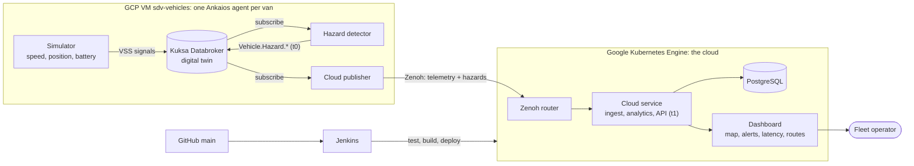

# SDV Fleet Operations & Hazard Monitor

A cloud system that watches a fleet of 3 simulated electric delivery vans in Oshawa.
Each van detects its own hazards (harsh braking, traction loss, overspeed, ...) and
sends them to the cloud, where a fleet operator sees them on a live map within a
fraction of a second, together with how safe and efficient each route is.

Group 5, Software Development Methods and Tools (Fall 2026):
Ahmad Musleh, Giancarlo Sotelo Lajo, Mohammad Dabash.

| Live (GCP) | |
|---|---|
| Dashboard with the real vans | http://136.65.193.93 |
| Dashboard with the built-in mock fleet | http://34.122.134.52 |

---

## How it works



**One hazard, start to finish:**

1. The **simulator** writes the van's signals (speed, braking, position, battery) into
   **Kuksa**, the van's digital twin, using standard VSS names like `Vehicle.Speed`.
2. The **hazard detector** reads those signals from Kuksa. When braking is too hard it
   writes a hazard back into Kuksa, with the time it saw it (**t0**).
3. The **cloud publisher** reads the hazard from Kuksa and sends it over **Zenoh**.
4. In the cloud, the **cloud service** receives it (**t1**), stores it in **PostgreSQL**
   and pushes it to the **dashboard**. Latency = t1 - t0.

**Who keeps it running:**

| Part | Runs on | Managed by |
|---|---|---|
| Kuksa, simulator, hazard detector, cloud publisher (x3 vans) | GCP VM `sdv-vehicles` | **Eclipse Ankaios**: starts them, restarts any that stop |
| Zenoh router, cloud service, PostgreSQL, dashboards | GKE | **Kubernetes** |
| New code on `main` | GitHub to GKE | **Jenkins**: test, build, deploy (checks GitHub every 2 minutes) |

## Phase 1 status

| Feature (charter, Phase 1 Must) | Status | How |
|---|---|---|
| Simulated fleet | Done | 3 vans on Routes A, B, C (`vehicle/simulator`) |
| Vehicle digital twin | Done | Kuksa Databroker 0.6.0 per van, VSS 5.1 + our overlay (`vehicle/vss/fleet_overlay.json`) |
| Hazard detection on the vehicle | Done | `vehicle/hazard_detector`, using the Kuksa Python SDK (see Velocitas below) |
| Vehicle-to-cloud transport | Done | Eclipse Zenoh 1.10 router on GKE |
| Vehicle software management | Done | Eclipse Ankaios 1.0.4, one agent per van, generated from `config/fleet.json` |
| Cloud ingestion and storage | Done | PostgreSQL 16 on GKE (`deploy/k8s/fleet-db.yaml`) |
| Live dashboard | Done | Map, fleet status, alert queue, latency, route performance |
| CI/CD | Done | GitHub Actions runs the tests on every PR; Jenkins deploys `main` to GKE |
| Latency measurement | Done | t0 on the vehicle, t1 in the cloud; results below |
| Velocitas app | Deferred | Tested and dropped for Phase 1; reason below |

**Latency** (50 injected hazards plus the vans' own, VM in us-central1-a to GKE):

| Hazards | Median | p95 | Max | Target |
|---|---|---|---|---|
| 106 | 58 ms | 64 ms | 154 ms | p95 < 2,000 ms: **pass** |

Most of the 58 ms is a 50 ms wait in the publisher, so all of a hazard's signals
arrive before it is sent. Both machines keep time with Google's NTP servers.

**Why not Velocitas (yet).** We tested velocitas-sdk 0.15.7 against our Kuksa
Databroker 0.6.0. It reads and subscribes to signals, but it can only write actuator
targets (our hazard signals are sensors), needs an extra MQTT broker per app, pins old
gRPC/protobuf versions that conflict with kuksa-client, and its last release was in
July 2025, which is the risk listed in our charter. It would add parts without adding a
feature, so the detector uses the Kuksa Python SDK. The hazard rules are separate from
the Kuksa code (`vehicle/hazard_rules`), so adding Velocitas later only changes the
detector's input and output.

---

## 1. Run the demo (Windows)

### Install Python (once)

1. Open **Command Prompt** and type `python --version`.
   If it shows **3.11 or newer**, skip to "Start the demo".
2. Otherwise, install Python from <https://www.python.org/downloads/>.
   On the first installer screen, tick **"Add python.exe to PATH"**.
3. Close and reopen Command Prompt, then check `python --version` again.

### Start the demo

**Easy way:** double-click **`run_demo.bat`**.
The first run creates a `.venv` folder and installs the packages (about a minute).
The dashboard opens in your browser at <http://127.0.0.1:8000>.

**Manual way** (Command Prompt, inside the project folder):

```bat
python -m venv .venv
.venv\Scripts\activate
pip install -r requirements.txt
python run_demo.py
```

Stop with **Ctrl+C**.

### Options

| Command | What it does |
|---|---|
| `python run_demo.py` | 3 vans + cloud + dashboard |
| `python run_demo.py --inject 50` | also injects 50 hazards for the latency test (about 2 minutes) |
| `python run_demo.py --port 8080` | use another port |
| `python run_demo.py --time-scale 25` | vans move faster, so trips finish sooner |
| `python run_demo.py --seed 7` | a different (but repeatable) demo |
| `python run_demo.py --no-browser` | do not open the browser |
| `python run_demo.py --databroker kuksa` | use the real Kuksa Databrokers (see below) |

With `run_demo.bat` you can pass the same options: `run_demo.bat --inject 50`.

### Start the demo (macOS / Linux)

**Easy way:** run **`./run_demo.sh`** — it finds a Python 3.11+ interpreter, creates `.venv`
and starts everything. The same options work: `./run_demo.sh --inject 50`.

**Manual way:** macOS ships Python 3.9, which `run_demo.py` rejects, so name a newer one
explicitly (install with `brew install python@3.13` if you do not have it):

```bash
python3.13 -m venv .venv
.venv/bin/pip install -r requirements.txt
.venv/bin/python run_demo.py
```

### Use the real Kuksa Databroker

Needs Docker. One Databroker per van (ports 55555, 55556, 55557), each loaded with
VSS 5.1 plus our overlay `vehicle/vss/fleet_overlay.json` (`Vehicle.Fleet.*`, `Vehicle.Hazard.*`):

```bash
docker compose -f deploy/kuksa/docker-compose.yml up -d
python run_demo.py --databroker kuksa --inject 50
docker compose -f deploy/kuksa/docker-compose.yml down
```

The vehicle apps then read and write real VSS signals in Kuksa. Zenoh and the
database are still fakes until their own branches land.

### Run the vans with Eclipse Ankaios (Linux)

Ankaios starts and supervises each van's software from one manifest,
`deploy/ankaios/state.yaml`: per van a Kuksa Databroker, the simulator and the
hazard detector, each in its own container, with one Ankaios agent per van.
The manifest is generated from `config/fleet.json`, so adding a van is one line there.

Needs podman and Ankaios 1.0 (`ank-server`, `ank-agent`, `ank`):

```bash
sudo apt install -y podman
curl -sfL https://github.com/eclipse-ankaios/ankaios/releases/download/v1.0.4/install.sh | bash -s -- -v v1.0.4 -t none
```

Build the two images, then start the server and one agent per van (separate terminals):

```bash
podman build -f deploy/docker/databroker.Dockerfile -t localhost/sdv-fleet/databroker:dev .
podman build -f deploy/docker/vehicle.Dockerfile -t localhost/sdv-fleet/vehicle:dev .
python -m tools.ankaios_manifest          # only after changing config/fleet.json
ank-server --insecure --startup-manifest deploy/ankaios/state.yaml
for v in veh-01 veh-02 veh-03; do ank-agent --insecure --name $v --server-url http://127.0.0.1:25551 & done; wait
ank -k get workloads                       # 9 workloads, all Running(Ok)
```

If a container stops, Ankaios starts it again (`restartPolicy: ALWAYS`). Without
`--zenoh` the manifest has no cloud_publisher: the fake Zenoh only works inside
one process, so these vans need a real Zenoh router to reach a dashboard.

### Everything real on GCP: vans on a VM, cloud on GKE, Zenoh in between

```
sdv-vehicles VM (Ankaios, 3 agents)            GKE: sdv-cloud pod                     GKE: sdv-fleet-db
  per van: Kuksa + simulator + detector  --->  Zenoh router + cloud service  --->  PostgreSQL
           + cloud_publisher (Zenoh)            (internal LB :7447)  dashboard (public LB :80)
```

1. Cloud side. Jenkins deploys `deploy/k8s/fleet-db.yaml` and `deploy/k8s/cloud.yaml` on
   every commit to main, next to the mock dashboard. Only the database password is set
   up by hand, once (see the top of `fleet-db.yaml`). By hand it is:

   ```bash
   IMAGE=us-central1-docker.pkg.dev/<project>/sdv-fleet/sdv-fleet-cloud:<tag>
   gcloud builds submit --config cloudbuild.yaml --substitutions _IMAGE=$IMAGE .
   kubectl apply -f deploy/k8s/fleet-db.yaml
   kubectl apply -f <(sed "s|IMAGE_PLACEHOLDER|$IMAGE|" deploy/k8s/cloud.yaml)
   kubectl get service sdv-cloud sdv-zenoh   # public dashboard IP, internal Zenoh IP
   ```

   The cloud service stores telemetry, alerts and trips in PostgreSQL
   (`DATABASE_URL=postgresql://...`); without `DATABASE_URL` it uses SQLite in memory.

2. Vehicle side: on an Ubuntu VM in the same VPC, with podman and Ankaios installed,
   copy the repository and run, with the internal Zenoh IP from step 1:

   ```bash
   sudo deploy/ankaios/setup-vm.sh tcp/<sdv-zenoh-ip>:7447
   ```

   Ankaios then runs 12 workloads (4 per van) as systemd services, so the fleet
   comes back after a VM restart.

3. Latency test (on the VM):

   ```bash
   sudo podman run --rm --net=host -v $PWD/tools:/srv/tools:ro --entrypoint python \
       localhost/sdv-fleet/vehicle:dev -m tools.inject_hazards --ports 55555,55556,55557 --count 50
   ```

   Result on 2026-10-19 (VM in us-central1-a to GKE, 64 hazards): median 58 ms,
   p95 65 ms, max 66 ms. The publisher waits 50 ms for a hazard's signals to
   settle, which is most of that time.

To save credits between demos: `gcloud compute instances stop sdv-vehicles` and
`kubectl scale deployment sdv-cloud --replicas=0`; start them again the same way.

### What you will see

- **Map:** the 3 vans (01, 02, 03) moving on Routes A, B and C in Oshawa, and a dot
  for every hazard (yellow = warning, orange = high, red = critical). A van with an
  active hazard pulses red. The map needs internet for the street tiles.
- **Fleet:** speed, battery, trip number and odometer for each van.
- **Alerts:** new hazards appear at the top with their latency. Click **Acknowledge**.
  Tick **Show resolved** to see old alerts.
- **Hazard latency:** median, 95th percentile and max of t1 - t0 (target: p95 under 2 s).
- **Route performance:** filled in after the first full trip of each van (about 2 minutes).
  Route B (downtown) should have the most hazards per 100 km.

### Suggested demo script (Maria's scenario, about 5 minutes)

1. Start `run_demo.bat --inject 50`. Show the 3 vans live and the "Mock data" badge.
2. Wait for a red **Traction loss** or orange **Harsh braking** alert. Show the
   pop-up, the red dot on the map and the latency of that alert.
3. Click **Acknowledge** on it.
4. After about 2 minutes, show the Latency panel (50+ hazards, p95 well under 2 s)
   and the Route table (Route B has the highest hazards per 100 km).
5. Explain that the latency is small because the network is simulated; the real
   number comes when Zenoh runs between two VMs.

---

## 2. Run the tests

```bat
pip install -r requirements-dev.txt
python -m pytest
```

The same tests run in GitHub Actions on every pull request (`.github/workflows/ci.yml`).
`tests/test_end_to_end.py` checks the whole chain, from a hard-braking signal on a van
to an alert in the cloud, in under 2 seconds (FR-19).

---

## 3. How the code is organised

```
config/fleet.json            vans, routes and speed limits (read by both halves)
fakes/                       stand-ins for Kuksa and Zenoh, for the one-process demo and tests
vehicle/                     everything that runs on a van              (owner: Ahmad)
  common/                    config, VSS paths, Databroker + Zenoh connection
  hazard_rules/              pure hazard rules (Thresholds, Finding, evaluate)
  simulator/                 drives the van and writes VSS signals
  hazard_detector/           Detector: finds hazards, writes Vehicle.Hazard.* (t0)
  cloud_publisher/           Bridge: sends telemetry + hazards to the cloud
  vss/fleet_overlay.vspec    our custom VSS signals
  tests/
cloud/                       everything that runs in the cloud          (owner: Mohammad)
  app/main.py                CloudService + REST API + WebSocket
  app/analytics.py           FleetAnalytics, Twin, TripTracker (no I/O)
  app/store.py               Store: all database code
  app/transport.py           Zenoh connection (cloud side)
  app/static/                the dashboard                              (owner: Giancarlo)
  db/                        SQL schemas (SQLite for the demo and tests, PostgreSQL in the cloud)
  tests/
tools/inject_hazards.py      injects hazards for the latency test
tests/test_end_to_end.py     integration test
deploy/                      Dockerfiles, Ankaios, Kubernetes, Jenkins (see deploy/README.md)
.github/workflows/ci.yml     CI: run the tests                          (owner: Giancarlo)
run_demo.py / .bat / .sh    start everything in one process (demo on a laptop)
```

Rules that keep us from blocking each other:

- **The vehicle and cloud halves never import each other.** They only share the two
  Zenoh keys (`fleet/{id}/telemetry`, `fleet/{id}/hazards`) and the JSON shape of
  the messages (see `Bridge.snapshot()` and `Bridge.flush_hazard()`).
- **Only three small files know whether a tool is real or fake:**
  `vehicle/common/databroker.py`, `vehicle/common/transport.py`, `cloud/app/transport.py`.
  The database choice lives only in `cloud/app/store.py`.
- **Logic has no I/O:** `hazard_rules` and `analytics.py` are plain functions and
  classes, so they are tested without a broker or a database.

### Environment variables (used when an app runs on its own, e.g. under Ankaios)

| Variable | Used by | Mock | Real data |
|---|---|---|---|
| `DATABROKER` | vehicle apps | `fake` | `kuksa` |
| `DATABROKER_HOST`, `DATABROKER_PORT` | vehicle apps | `127.0.0.1`, `55555` | Databroker of that van |
| `TRANSPORT` | vehicle apps, cloud | `fake` | `zenoh` |
| `ZENOH_ENDPOINT` | vehicle apps, cloud | `tcp/127.0.0.1:7447` | router on the cloud VM |
| `VEHICLE_ID`, `ROUTE_ID`, `SPEED_LIMIT_KMH` | vehicle apps | `veh-01`, `A`, `50` | set per van in the Ankaios manifest |
| `DATABASE_URL` | cloud | `sqlite:///:memory:` | `postgresql://...` |
| `PORT` | cloud | `8000` | |
