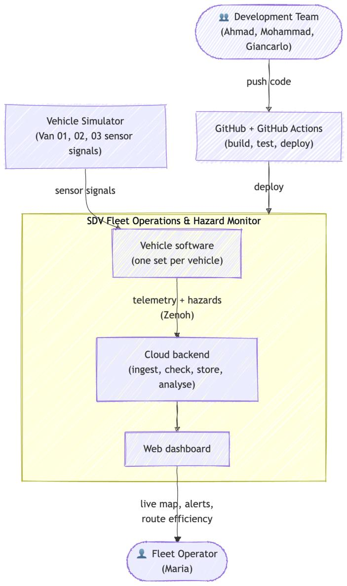
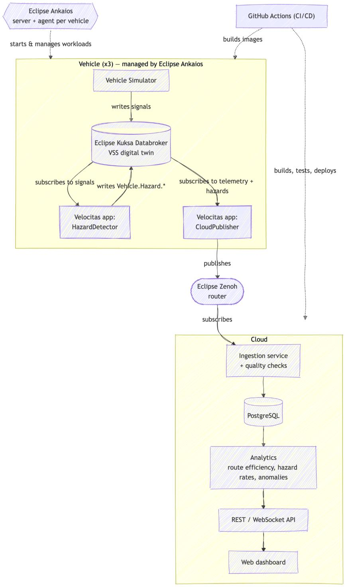

<!--
Converted from "1 Project Charter v2.pdf" (Version 2.0, October 2026) on 2026-11-14.
The wording is unchanged. The two diagrams are the original images from the PDF.
Do not edit the charter here: record any change or deviation in specs/, with the reason.
-->

# Project Charter v2: SDV Fleet Operations & Hazard Monitor

**Group 5:** Ahmad Musleh, Giancarlo Sotelo Lajo, Mohammad Dabash
**Version:** 2.0, October 2026

## Changes Since v1

- **Hazards and route analytics are now connected.** Every hazard event is tagged with the vehicle's route and location. Route efficiency now combines operating data (energy per km, average speed, stop time) with safety data (hazards per 100 km and hazard hotspots). Operators can see which routes are both inefficient and unsafe.
- **"Real time" is now defined and measured.** Hazard latency is the time from hazard detection on the vehicle to the alert appearing in the cloud. Our target is under 2 seconds for 95% of hazards (see Section 2).
- Added a usage scenario, a context diagram, a prioritized feature table, the high-level architecture, task owners with backups, and a process plan.

---

## 1. Project Overview

We are building a cloud-based system that monitors a fleet of software-defined vehicles. Each vehicle has a digital twin that is updated with its sensor data (speed, location, battery or fuel level, engine status and hazard events). Hazards are detected on the vehicle with Eclipse SDV tools and sent to the cloud, where all the data is quality-checked, stored and analysed. A web dashboard shows fleet operators live hazard alerts and how efficient and safe each route is. A CI/CD pipeline deploys the system automatically.

---

## 2. Objectives

- Create a digital twin for each vehicle in a simulated fleet of at least three vehicles.
- Detect safety hazards on the vehicle, such as harsh braking and traction loss, and deliver them to the cloud with an end-to-end latency under 2 seconds (95th percentile).
- Link safety to operations: tag every hazard with its route and location, and calculate route efficiency from both operating data and hazard rates.
- Provide a web dashboard with a live map, hazard alerts and route performance.
- Integrate and extend four Eclipse SDV projects: Kuksa, Velocitas, Ankaios and Zenoh.
- Deploy the system continuously with CI/CD.

**How hazards relate to route analytics.** Harsh braking and traction loss are safety events, but they also affect the business. Frequent harsh braking means stop-and-go traffic, which increases energy use and brake wear. Traction loss points to risky road sections. Because every hazard carries a route ID and a location, the cloud can calculate hazards per 100 km for each route and show hotspots on the map. The operator can then compare routes on two dimensions, efficiency and safety, and decide which ones to reschedule or replace.

**How latency is defined and measured.** Hazard detection runs on the vehicle, so the vehicle reacts locally. The cloud side is "soft real time": it must inform the operator quickly, but it doesn't control the vehicle.

- **Detection time (t0):** the HazardDetector app records a timestamp when it raises a hazard.
- **Cloud time (t1):** the ingestion service records a timestamp when the hazard event arrives.
- **Latency = t1 − t0.** All components run on cloud VMs with synchronized (NTP) clocks.
- **Target:** under 2 seconds for 95% of hazards. We will report the median, 95th percentile and maximum over at least 50 injected hazards, and show them during the demo.

---

## 3. Usage Scenario

Maria is a fleet operator at a small delivery company. Her three electric vans run fixed routes across the city: Van 01 on Route A, Van 02 on Route B and Van 03 on Route C. Ahmad, Mohammad and Giancarlo are the development team.

1. At the start of the shift, Maria opens the dashboard and sees the three vans moving on the live map, each with its speed, battery level and status.
2. On Route B, Van 02 hits a wet section of road and its traction control activates. The HazardDetector app on the van combines speed and traction signals and raises a traction loss hazard, tagged with Route B and the van's location.
3. The event travels over Zenoh to the cloud and appears in Maria's alert queue within 2 seconds. The van's marker turns red on the map. Maria acknowledges the alert and contacts the driver.
4. During the week, Van 02 records several more harsh-braking and traction-loss events on the same stretch of Route B.
5. At the end of the week, Maria opens the route report. Route B has the highest hazard rate (hazards per 100 km) and below-average efficiency (more energy per km and more stop time than the other routes). The hotspot map shows where the events cluster, so she moves Route B's morning deliveries to a different road.

**What we will measure and demo**

- Hazard latency (median, 95th percentile and maximum) over at least 50 injected hazards
- Hazard detection: every injected harsh-braking and traction-loss event is detected and appears on the dashboard
- Route report: hazards per 100 km and efficiency per route, calculated from completed trips
- Data quality: records with missing or out-of-range values are flagged and not stored silently
- CI/CD: a change merged to main is deployed automatically

---

## 4. Context Diagram

- **System boundary:** the vehicle software (one set per simulated vehicle) and the cloud backend with its dashboard.
- **Actors:** the fleet operator (main user) and the development team.
- **External systems:** the vehicle simulator, which provides the sensor signals, and GitHub with GitHub Actions for CI/CD.

---

## 5. Main Features

| Feature | Description | Priority | Phase |
|---|---|---|---|
| Simulated fleet | At least 3 vehicles driving routes and producing VSS signals | Must | 1 |
| Vehicle digital twin | Kuksa VSS model per vehicle, extended with fleet and hazard signals | Must | 1 |
| Hazard detection | Velocitas app detecting harsh braking and traction loss, tagged with route and location | Must | 1 |
| Vehicle-to-cloud transport | Zenoh carries telemetry and hazard events to the cloud | Must | 1 |
| Vehicle software management | Ankaios starts and manages each vehicle's apps | Must | 1 |
| Cloud ingestion and storage | Receive events and store them in PostgreSQL | Must | 1 |
| Live dashboard | Live map, vehicle status and hazard alert queue | Must | 1 |
| CI/CD pipeline | Build, test and deploy automatically on merge to main | Must | 1 |
| Latency measurement | Timestamp hazards at detection and arrival, and report latency | Must | 1 |
| Data quality checks | Flag missing, out-of-range and delayed values before storing | Must | 2 |
| Route efficiency and safety | Energy per km, stop time and hazards per 100 km for each route | Must | 2 |
| Hazard hotspot map | Show where hazards cluster along each route | Should | 2 |
| Cloud anomaly detection | Rule-based checks, such as a sudden battery drop or a lost connection | Should | 2 |
| Fleet history | Past trips and trends on the dashboard | Should | 2 |
| Remote software update | Push new hazard thresholds or app versions to vehicles through Ankaios | Could | 2 |
| ML-based detection | A simple ML model for anomaly detection | Could | 2 |

The Must features cover the full data path plus the two links the feedback asked about (hazards to routes, and measured latency). The Should and Could features are our buffer and can be dropped without breaking the core system.

---

## 6. High-Level Architecture

| Package | Role in our system |
|---|---|
| Eclipse Kuksa | Runs a Databroker on each vehicle that holds the vehicle's current signals in the VSS format. This is the in-vehicle digital twin. We extend VSS with our own fleet signals (route ID, trip) and hazard signals (type, severity). |
| Eclipse Velocitas | Framework for our two vehicle apps. The HazardDetector subscribes to signals in Kuksa and raises hazards. The CloudPublisher sends telemetry and hazard events to the cloud. |
| Eclipse Ankaios | Starts and manages the workloads on each vehicle (Databroker, simulator, apps) from declarative manifests. |
| Eclipse Zenoh | Publish/subscribe transport from each vehicle to a Zenoh router in the cloud. |
| Cloud services (Python) | Ingestion, quality checks, storage in PostgreSQL, analytics, and the API used by the dashboard. |
| Dashboard (JavaScript) | Web interface for the fleet operator. |

---

## 7. Team Roles

| Task | Primary owner | Backup |
|---|---|---|
| Vehicle simulation and Kuksa VSS model | Ahmad | Mohammad |
| Velocitas apps (HazardDetector, CloudPublisher) | Ahmad | Giancarlo |
| Ankaios setup and manifests | Ahmad | Giancarlo |
| Zenoh vehicle-to-cloud transport | Mohammad | Ahmad |
| Cloud ingestion, quality checks and PostgreSQL | Mohammad | Giancarlo |
| Analytics (route efficiency, hazard rates, anomalies) | Mohammad | Ahmad |
| Latency measurement and reporting | Mohammad | Ahmad |
| Web dashboard | Giancarlo | Mohammad |
| CI/CD pipeline and cloud deployment | Giancarlo | Ahmad |
| Requirements and UML diagrams | Giancarlo | Ahmad, Mohammad |
| Weekly process entries and submissions | Rotating weekly | All |

---

## 8. Process Plan

- **Lifecycle:** each week we follow the same cycle: update requirements → update UML → implement → test → integrate → write the weekly process entry. In Phase 2, each entry also notes how the UML and architecture changed.
- **Weekly meeting:** a short sync to review progress, demo what each person finished, and plan the next week.
- **Task tracking:** a GitHub Projects board with To do, In progress, Review and Done columns.
- **Code workflow:** feature branches and pull requests. Every pull request is reviewed by one other member, and CI must pass before merging to main.
- **Integration:** we integrate the full system early and keep it working, so problems show up before the checkpoint demo.

---

## 9. Scope

**In scope:** everything in the feature table (Section 5).

**Out of scope:** real vehicles or vehicle hardware, vehicle-to-vehicle communication, and mobile applications.

---

## 10. Tools and Technologies

- **Eclipse SDV:** Kuksa, Velocitas, Ankaios, Zenoh
- **Programming languages:** Python for the vehicle apps and cloud services; JavaScript for the dashboard
- **Other tools:** Docker, GitHub, GitHub Actions, PostgreSQL
- **Reference:** Eclipse SDV Fleet Management Blueprint

---

## 11. Risks

| Risk | Mitigation |
|---|---|
| Velocitas is less actively maintained and only works with an older Kuksa version | Use a compatible Kuksa version and start the Velocitas integration early |
| Ankaios needs Linux, but some team members use macOS or Windows | Run Ankaios on a shared Linux VM in the cloud |
| Learning several new tools in a short time | Split the tools between members and share what we learn in weekly meetings |
| Integration problems late in the project | Integrate early and test the full system in the CI pipeline |
| No new tools can be added in Phase 2 | Choose every tool we will need, including the database, during Phase 1 |
| Clock differences make latency measurements wrong | Run all components with NTP-synchronized clocks and check the offset before measuring |

---

## 12. Success Criteria

- The dashboard shows at least three vehicles live, with their current state.
- 95% of hazards reach the cloud within 2 seconds of detection, measured over at least 50 injected hazards.
- Every hazard is tagged with its route and location.
- Route efficiency and hazards per 100 km are calculated for each route from completed trips.
- Incoming data is quality-checked before it is stored.
- Changes merged to main are deployed automatically.
- All course deliverables are submitted on time.
